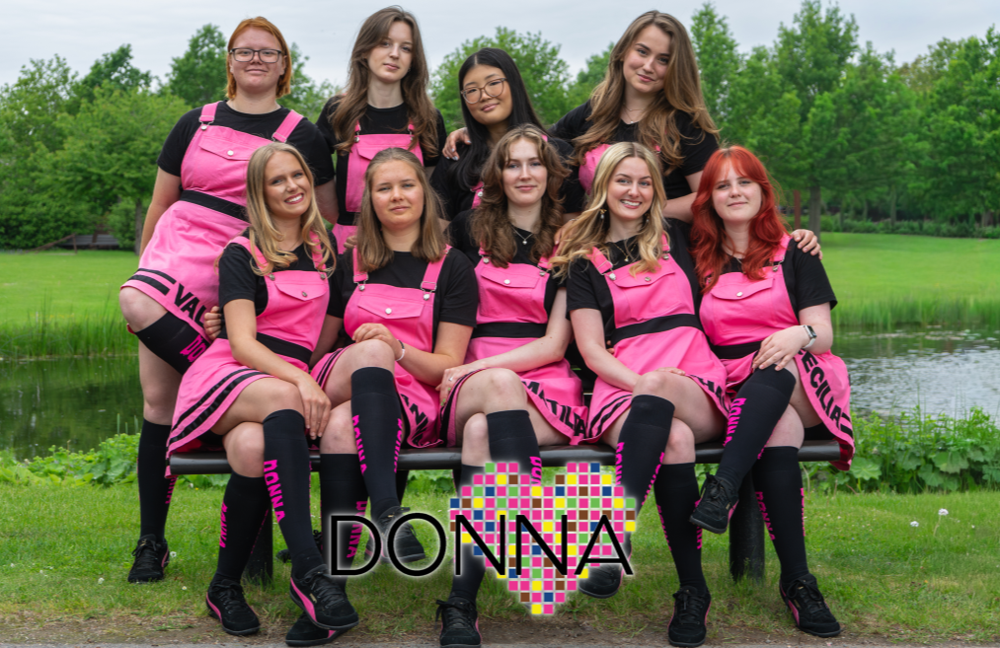
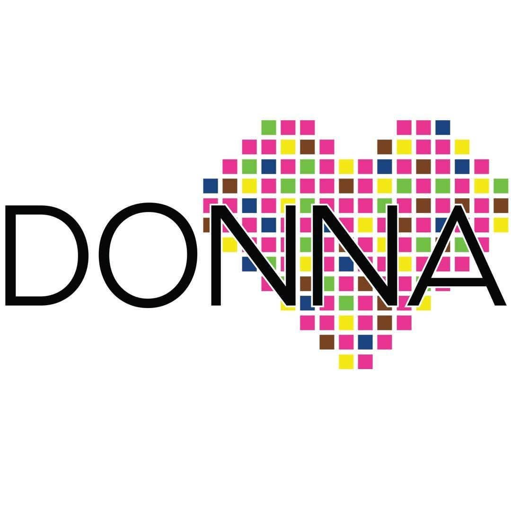

Donna är datateknologsektionens damförening och jobbar för att stärka sammanhållningen mellan alla tjejer och icke-binära på sektionen. Vi anordnar sittningar, företagsevent och andra roliga aktiviteter både själva men också tillsammans med andra föreningar och företag.

Mer information om Donna hittar du på vår hemsida, [här](https://donna.d-sektionen.se/).

<figure>

<figcaption>

Donna 26/27

</figcaption>

</figure>

För att inte missa våra evenemang kan det vara bra att hålla utkik på vår Facebooksida eller vårt Instagramkonto.

_Donna på sociala medier:_  
_[Donna på Facebook](http://www.facebook.com/donnad-sektionen)_  
_[Donna på Instagram](http://www.instagram.com/donna_dsektionen)_

**Frågor? Skriv till oss!  
Josefiné Sahlström (Ordförande 26/27)  
[ordf.donna@d-sektionen.se](mailto:ordf.donna@d-sektionen.se)  
**
