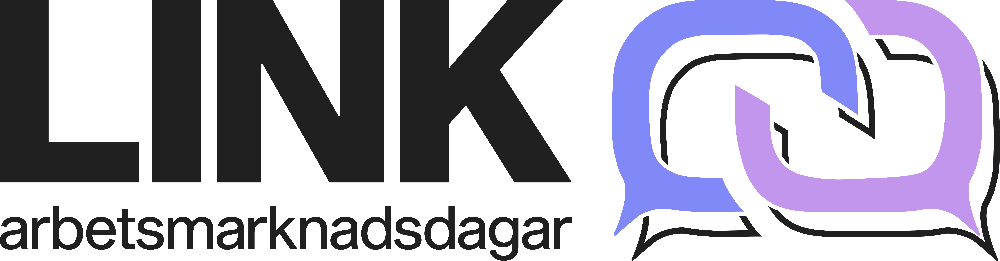

  

LINK-dagarna är de årliga arbetsmarknadsdagar inom data och IT vid Linköpings universitet som gemensamt arrangeras av Y- och D-sektionen. I år äger LINK-dagarna rum mellan den 6-21 november, och under denna period bjuds det på ett brett utbud av spännande företagsevent - allt från inspirerande föreläsningar till sociala aktiviteter.

Höjdpunkten är den avslutande mässan, där företag får möjlighet att visa upp sin verksamhet och nätverka med studenter med intresse och studier inom data och IT. Kvällen avslutas med den magiska och årliga banketten på Linköpings Konsert och Kongress där en exklusiv trerättersmiddag serveras tillsammans med underhållning i världsklass!

Vill du veta mer? Besök: [linkdagarna.se](http://linkdagarna.se/) för mer information

Vi ses på LINK-dagarna!
