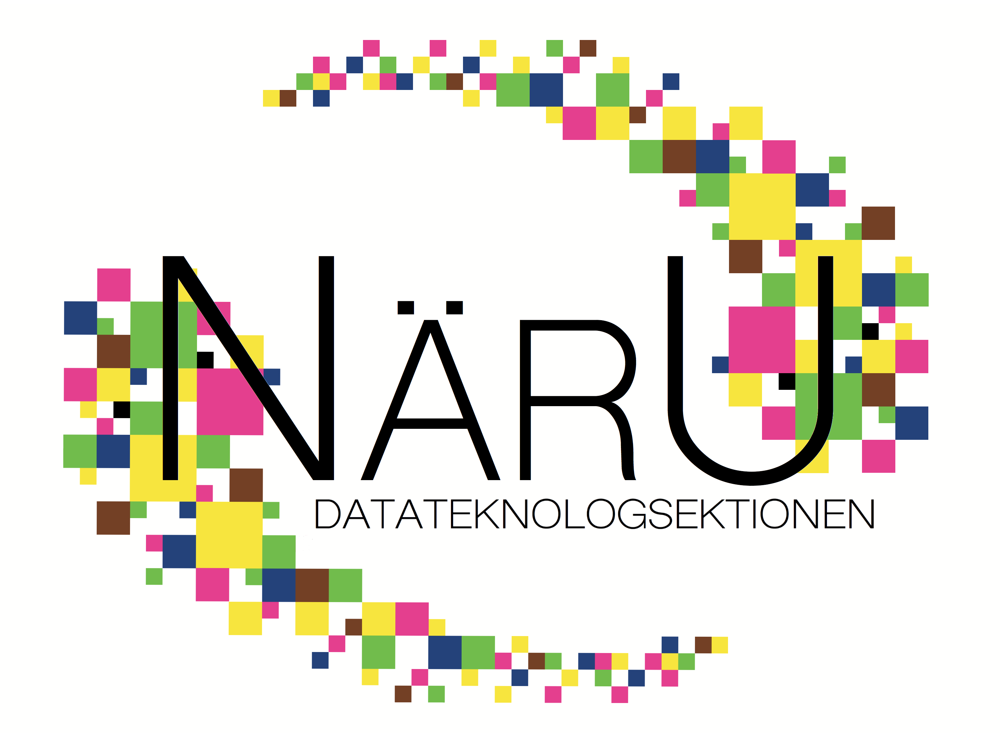

Näringslivsutskottets främsta uppgift är att sköta kontakten och samarbetet mellan sektionen och näringslivet. Det är vi som ansvarar för att vårda och utveckla kontakten mellan studenterna på sektionen mot vår huvudsponsor och samarbetspartners.

### Företag?

Information för företag och organisationer finner ni under [Företag](/foretag/).

### Företagskvällar och företagsluncher

För att du som D-student ska få en nära kontakt med näringslivet anordnar vi i Näringslivsutskottet ett antal företagskvällar och företagsluncher under året. Företagskvällarna och företagsluncherna hålls i syfte att ge dig som student en inblick i näringslivet och möjlighet att knyta värdefulla kontakter inför det framtida arbetslivet. Företagskvällar och företagsluncher börjar vanligtvis med att det besökande företaget håller en kort presentation för att sedan övergå till mingel med något ät- och drickbart.

### Annonsering

Vi i Näringslivsutskottet arbetar för att sprida information om lediga jobb, ex-jobb och företag till sektionens medlemmar. Håll utkik på hemsidan, i sektionens info-mejl och i sektionsrummen där vi kontinuerligt annonserar och sprider den senaste informationen.

Vi annonserar även på [vår Facebook-sida](https://www.facebook.com/datateknologsektionen), gilla den för att ta del av allt spännande som händer.

### Hjälp oss

Vi arbetar kontinuerligt med att förbättra sektionens näringslivsverksamhet och är därför i ett stort behov av dina idéer och åsikter.

- Har du som student egna önskemål på företag som du vill träffa på en företagskväll eller företagslunch?
- Har du kontakt med företag som är intresserade av Datateknologsektionen och kan vara intresserade av att samarbeta med oss?
- Har du tips eller idéer på hur vi kan förbättra vår verksamhet?

Mejla förslag och tips till Näringslivsansvarig.

**Marcus Kiil (Näringslivsansvarig 26/27)**  
[nara@d-sektionen.se](mailto:nara@d-sektionen.se)
