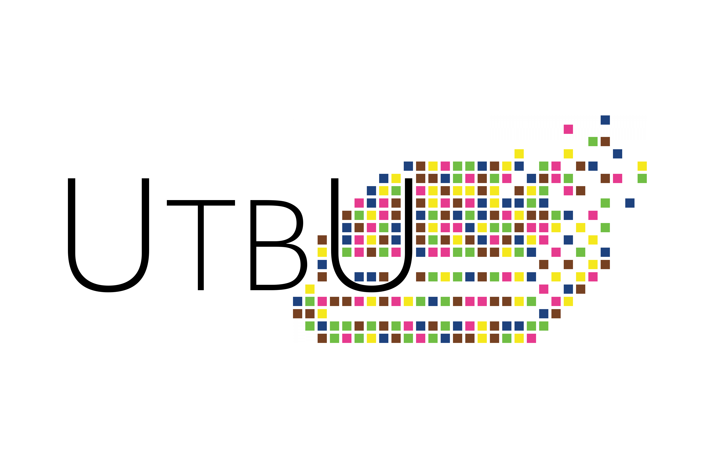

Utbildningsutskottet har i uppgift att bevaka utbildningen på våra program och är uppdelat i fyra mindre studienämnder, en för varje program. Utskottet ansvarar för att samla in kursutvärderingar. Dessutom arbetar utskottet med att utveckla kurser och se till att utbildningen håller högsta klass. Utskottets syfte är att tjäna som länk mellan studenter på programmet, Lintek och universitet. Denna text har som syfte att förklara vissa grundläggande begrepp och sammanhang när det gäller studiebevakning.

### Kontaktuppgifter

Utbildningsutskottets ordförande – [utbu@d-sektionen.se](mailto:utbu@d-sektionen.se)

SnOrdf D-programmet – [d-snordf@d-sektionen.se](mailto:d-snordf@d-sektionen.se)

SnOrdf IP-programmet – [ip-snordf@d-sektionen.se](mailto:ip-snordf@d-sektionen.se)

SnOrdf IT-programmet – [it-snordf@d-sektionen.se](mailto:it-snordf@d-sektionen.se)

SnOrdf U-programmet – [u-snordf@d-sektionen.se](mailto:u-snordf@d-sektionen.se)

### Studentrådet

Från och med verksamhetsåret 13/14 så har studienämnderna på D-sektionen genomgått en förändring för att hantera en större sektion. I Studentrådet sitter alla SnOrdfarna(Studienämndsordförande) samt Utbildningsutskottets Ordförande. Rådet finns där bland annat för att öka samarbetet mellan snordfarna och för att kunna diskutera större frågor som rör flera utbildningar.

### Studienämnderna för D, IT, IP och U

Studienämnden består av studenter som studerar på den utbildningen som studienämnden arbetar för. Det finns en studienämnd för varje utbildning. Det finns alltså en studienämnd för D, en studienämnd för IT, en studienämnd för IP och en studienämnd för U. Studentrådets Ordförande (SOrdf) sitter med i D-sektionens styrelse och väljs på sektionens vårmöte. Studienämnden D, IT, IP och U består av en SnOrdf (Studienämndsordförande) per program samt klassrepresentanter i årskurserna 1-3.

### Programnämnden för data- och medieteknik (DM)

Programnämnden ansvarar för att planera, följa upp och utvärdera de utbildningar den ansvarar för. De verkar även för ständiga kvalitetsförbättringar. Nämnden tar även fram utbildningsplaner, kursplaner, lässchema och tentamensschema. Det är även nämndens uppgift att besluta om tillgodo-räknande. Underlagen till det som beslutas i programnämnden arbetas fram i programplanegruppen (PPG/LoTTa för IT).

I programnämnden finns representanter för studenterna, institutionerna, yrkesrepresentanter, nämndordförande, nämndsekreterare, utbildningsledare samt studievägledare. Studenterna har tre ordinarie ledamöter i DM, 2 st SnOrdfar och LinTeks utbildningsansvarige. Eftersom studenterna har tre ledamöter med rösträtt finns stora möjligheter att påverka. Det skiljer sig dock sällan i röstningen i DM eftersom det oftast arbetas fram ett förslag i PPG som alla är nöjda med innan beslut tas i DM. Mer information om programnämnden finns [här](https://liu.se/organisation/liu/lith/programnamnden-for-data-och-medieteknik#:~:text=Masterutbildningar.%20Computer%20Science%20%C2%B7%20Cybersecurity.%20Mer%20information%20om%20n%C3%A4mndens%20program%20finns%20p%C3%A5%20LiU:s%20utbildningswebb.).

### Programplanegruppen (PPG)

PPG är ett arbetsutskott under DM. Nästan alla frågor som ska behandlas i DM förbereds här. T.ex. diskuteras läro- och timplaner, kursplaner, budget, tentaperioder och alternativa examinationsformer. PPG träffas regelbundet, vanligen var annan vecka.

På IT kallas PPG för LoTTa, vilket är en förkortning av ”Läro- och timplanegruppen med terminsansvariga”. Där sitter IT-SnOrdfen, programansvarig, utbildningsledare, alla terminsansvariga samt MTS-ansvarig (MTS står för människa-teknik-samhälle).

### Verkställande avdelningen

VA består bl.a. av LinTeks utbildningsansvarige, som representerar studenterna, och DM:s ordförande som representant för universitetet. VA tar beslut i frågor gällande dispens från spärregler, godkännande av praktik och mindre beslut som inte kräver hela DM. VA tar även beslut i frågor som är brådskande och inte hinner tas upp i DM.

### Utvärdering av kurser

På D-sektionen håller alla studienämnder examinatorsmöten under samma vecka(eller två vid behov) och detta kallar vi för en utvärderingsperiod. En utvärderingsperiod äger rum efter varje läsperiod (4 gånger per år). Under denna vecka medverkar studenter som gått kurserna som ska utvärderas, examinatorer som håller i kursen och sedan SnOrdfarna som ska agera som medlare mellan studenterna och examinatorerna.

För att lösa problem som uppstår i början av en kurs kan man kontakta klassrepresentanter eller studienämndsordförande för sitt program. Dessa har även som uppgift att föra studenternas talan gentemot examinatorer och berörda parter mellan utvärderingsperioder. På så sätt kan man även påverka den aktuella utbildningssituationen och inte bara utvärdera en nästan slutförd kurs. Dessutom arbetas det just nu även med halvtidsutvärderingar inom flera kurser.

Alla utvärderingar finns på sektionens hemsida under respektive studienämnd.

#### _D, IP och U_

I årskurserna 1-3 finns ett antal klassrepresentanter utspridda i klasserna. Det är i dagsläget två-tre från varje klass. De tar reda på vad andra i klassen tycker om kurserna och framför det på årskursrådet för sin årskurs och diskuterar åsikterna som kommer fram.

#### _IT_

På IT diskuteras kursen först igenom på ett basgruppsmöte som finns i årskurserna 1-3. Sedan sammanställs åsikterna från varje basgrupp så att det går att framföra allas åsikter vid examinatorsmöten.

### LinTeks Utbildningsråd (UR)

Medlemmar i LinTeks Utbildningsråd är alla sektionernas studienämndsordföranden, utbildningsansvarig, vice kårordförande med internationaliseringsansvar, Norrköpingsansvarig samt kårordförande.

I UR diskuteras övergripande frågor och andra frågor som rör alla utbildningar. Där kan studienämnderna ta lärdom av varandras erfarenheter och dessutom få en möjlighet att driva en gemensam åsikt i bl.a. programnämnder.

Det är även UR som röstar om vem som ska tilldelas pedagogikpriset ”Gyllene Moroten”, vilket delas ut varje år av LinTek. Varje sektion nominerar en kandidat till årets mest pedagogiska undervisare.
