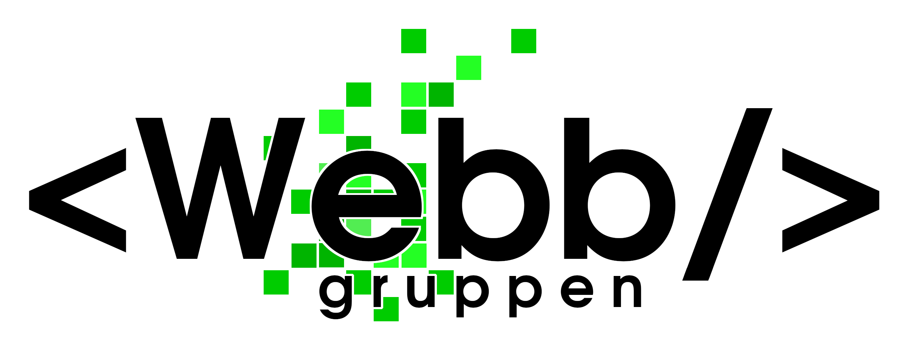

Webbutskottet är ansvarig för funktionaliteten på sektionens hemsida och dess tjänster. Förutom att se till att nuvarande system är i drift arbetar gruppen också med utveckling av ny funktionalitet som ämnar gagna medlemmarna och sektionens verksamhet i stort.

Om det är någon funktionalitet på våra sidor som du tycker saknas eller något som inte fungerar som det ska, eller om du har frågor om utskottet, kontakta webmaster.

## Våra arbetsuppgifter

Utskottet jobbar med flera projekt som har sitt gemensamma syfte i att underlätta andra utskotts arbete.

### Informationssidan

Sidan du besöker just nu, d-sektionen.se, har som syfte att vara en informationskälla. Sidan är byggd med [Wordpress](https://sv.wordpress.org/) med grundläggande funktionalitet framtagen under 2014 och den började användas som primär hemsida för sektionen i slutet av mars 2015. Informationen på sidan ansvarar [infoutskottet](https://d-sektionen.se/info/) för.

### Medlemsportalen

Medlemsportalen, [medlem.d-sektionen.se](http://medlem.d-sektionen.se), är sidan som från och med 2019 innehåller de medlemstjänster som kräver inloggning. Dessa tjänster är bland annat bilbokning, Netlight-låset, röstningssystemet och checkin-systemet (blipp).

Sidan är byggd med en frontend i React och en backend i Django.

### Medlemsregistret

Vi ansvarar även för sektionens medlemsregister. Status om ditt sektionsmedlemskap finns på [medlem.d-sektionen.se](http://medlem.d-sektionen.se). Behöver ditt utskott uppgifter från medlemsregistret? Kontakta webmaster.

### Övrigt

Vi har även några mindre projekt såsom koden bakom sektionens julkalender, infomailsystemet med mera.

## Vad vi inte gör

Webbutskottet ansvarar inte för:

- Mailkonton i G-Suite
    - Hanteras av sekreteraren ([sekreterare@d-sektionen.se](mailto:sekreterare@d-sektionen.se))

- Informationen på hemsidan
    - Hanteras av [infoutskottet](https://d-sektionen.se/info/)

- Teknikprylar i sektionsrummen
    - Hanteras av [Werkmästeriet](https://d-sektionen.se/werkmasteriet/)

**Otto Roming (Webmaster 26/27)  
[webmaster@d-sektionen.se](mailto:webmaster@d-sektionen.se)**
