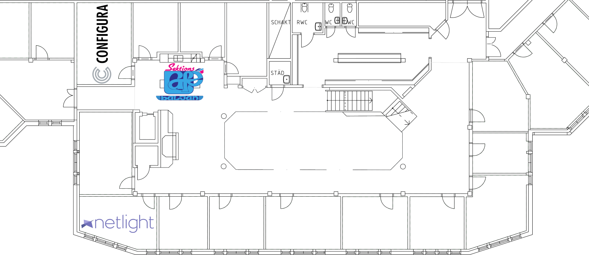
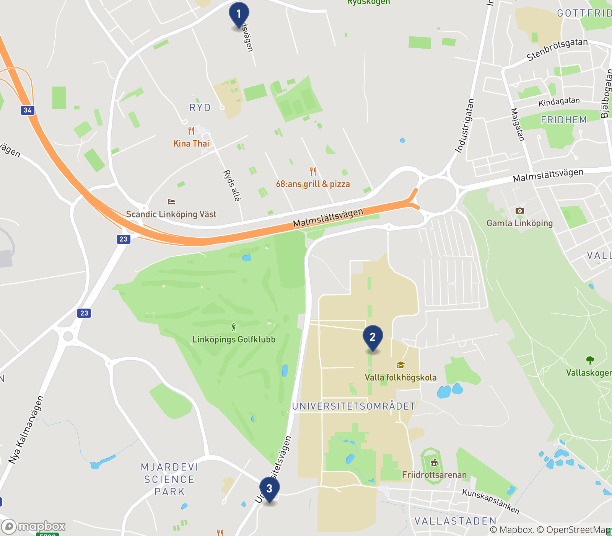
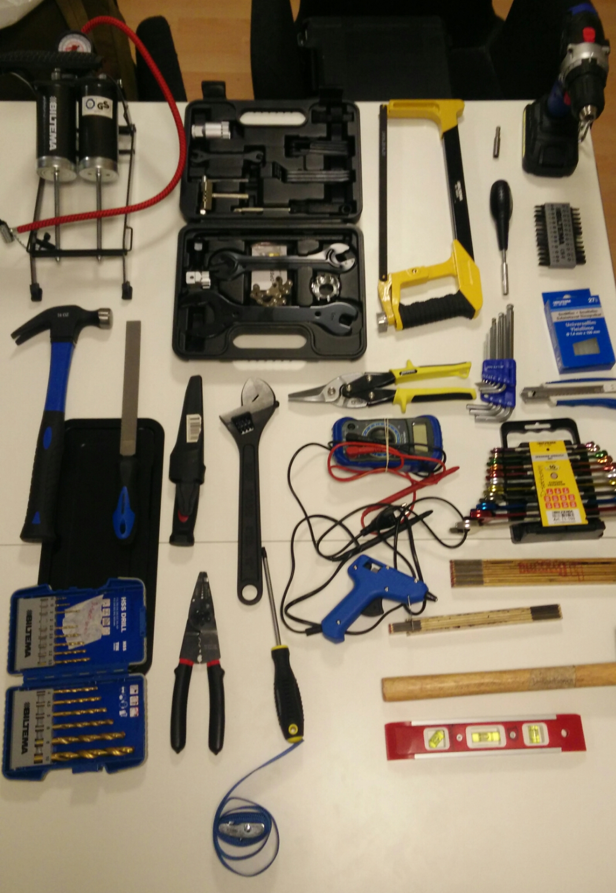

_Werkmästeriet är oljan i kugghjulen, vallan på skidorna, dippen till pommestallriken och skumkronan på ölen._

Werkmästeriets uppgift är att sköta om sektionens lokaler, inventarier och fordon, så utskottens arbete kan utföras på ett effektivt, strukturerat och trevligt sätt.

Några exempel på vad Werkmästeriet gjort under åren är:

- Uppdaterat städrutiner för sektionsrummen. Dessa finns fint uppsatta på dörrarna i Bettan och Config
- Att det alltid ska finnas gratis kaffe för sektionsmedlemmar i Bettan
- Sålt ovvar och delat ut sektionsväskor till ettan
- Hanterat praktikalia på sektionsmöten
- Uppdaterat bilavtalet för Kianu Revs och Harrizzon Ford
- Införskaffat nya möbler, målat om och i allmänhet snyggat till i sektionsrummet Bettan.
- Möblerat om och införskaffat nya datorskärmar i sektionsrummet Configura.
- Möjliggjort för medlemmar att ta sig in i sektionsrummet Bettan via sektionshemsidan
- Köpt in nya verktyg till sektionen, samt en vagn för transporter till och från B23
- Byggt en ny övervåning i Gula Ladan på VTI

Utöver de ovan nämnda projekten och de dagliga rutinerna, som till exempel att låna ut nycklar, laga bilen och köpa kontorsvaror, driver Werkmästeriet en hel drös mindre projekt, som diverse lagning och städning.

## FAQ

- Vem har bokat bilen klockan X? [_Se bokningssidan._](https://medlem.d-sektionen.se/booking)
- Får vi lämna saker i Bettan/Configura/KontorETT? _Endast under korta perioder, fråga ReningsWerk först och ställ sakerna bakom åt sidan så de kommer undan. Kom ihåg att B23 finns och de flesta utskotten har en egen hylla att nyttja._
- Jag har inte åtkomst till KontorETT men vill lämna tillbaka nycklar, hur gör jag? _Kontakta **först** någon i ditt utskott som har nyckel, alternativt kontakta vederbörande werkare (VägWerk/KraftWerk/ReningsWerk) eller Intendenten för att komma in._
- Kan vi sätta loggor och flames på bilen? _Nej. För utförligare svar: prata med Intendenten (om du vill höra "Nej" igen)_
- Vi behöver komma åt VTI men grinden är stängd, hur kommer vi in? _Öppna den. Tidigare har bilgrinden på VTI varit öppen vardagar 07:00-17:00. Skulle det vara fallet igen har vi ingen möjlighet att låsa upp den på andra tider, men gånggrinden går att låsa upp._
- Finns det kaffe i Bettan? _Kanske, du får kolla! Annars är det bara att brygga på. Kolla in [kaffeguiden](https://www.youtube.com/watch?v=FKHlFvTbyKU) om du känner dig osäker. Glöm inte att skriva upp på tavlan när kaffet är bryggt._
- Hur loggar jag min bilkörning? _[Länk till bilformulär.](https://d-sektionen.se/loggbok)_

## Sektionsrummen

_**Kontaktperson**: Ludvig Bengtsson ([reningswerk@d-sektionen.se](mailto:reningswerk@d-sektionen.se)) för allmänna frågor eller för frågor om teknisk utrustning._

D-sektionen har två sektionsrum: Bettan, Configura. Bettan ligger i Kårallen på nedervåningen, se kartan nedan. Configura ligger på ovanvåningen i HusETT (bakom A-huset).

Sektionsrummen är inga förråd, speciellt inte om man inte kontaktar ReningsWerk innan.

### Configura

Configura är en studiemiljö för alla D-sektionens medlemmar. Här kan man få bra med plugg gjort, socialisera. Rummet är försett med bland annat kaffekokare, kyl, tv och utrustning för möten på distans.

### Bettan

Bettan är sektionens uppehållsrum, dit man kan komma till exempel för att fördriva lite tid, eller kanske till och med plugga. Alla sektionens medlemmar kan komma in i Bettan när Kårallen är öppet. Rummet kan enkelt låsas och låsas upp via [medlemsportalen](https://medlem.d-sektionen.se/netlight).

## Bilarna

_**Kontaktperson**: Jessica Andersson ([vagwerk@d-sektionen.se](mailto:vagwerk@d-sektionen.se))_

Den "allmänna" sektionsbilen är en manuell Kia C'eed '14 utrustad med dragkrok. Denna bil får brukas både för personligt bruk och sektionsverksamhet. Mer info finns i bilavtalet och i handskfacket i bilen.

Forden är en S-Max också utrustad med dragrok, men med automatlåda och sju säten istället för fem. Denna bil får **endast** brukas för sektionsverksamhet, och alla bokningar måste motiveras och sedan godkännas av VägWerk för att vara giltiga. Mer info finns i bilavtalet och bokningsavtalet. Utöver bilarna finns även släpvagn, spännband och cykelhållare att tillgå.

Glöm inte att **alla** som kör någon av bilarna måste [logga sin körning](https://d-sektionen.se/loggbok).

## Våra Förråd

_**Kontaktperson**: Ferdinand Kouhia ([kraftwerk@d-sektionen.se](mailto:kraftwerk@d-sektionen.se))_

D-sektionen har ett antal lokaler som kan användas som förråd\*.

_Sektionens förråd: Pappers (1), B23 (2), VTI (3)_

### B23

B23 ligger i B-husets källare, ingång 23. Där kan alla sektionens utskott få förvara begränsade mängder saker. B23 är vårt mest centrala och attraktiva förråd och bör därför inte fyllas upp med skrymmande saker som används sällan.

För att komma in i B23-källaren behöver man blippa sitt LiU-kort. Kontakta sektionskassören om du vill ha tillgång till B23-källaren med ditt LiU-kort.

### Pappers-Pappers

På Rydsvägen 278 ligger Pappers. Pappers är egentligen 4 förråd: STABEN-Pappers, D-Group-Pappers, Toalett-Pappers samt Pappers-Pappers. Namnen härleder vad förråden används till. D-group och STABEN har sina förråd och sektionen delar sedan på Toalett-Pappers och Pappers-Pappers. Toalett-Pappers används för att förvara större mängder av förbrukningsmaterial samt ovvar, medans Pappers-Pappers används som arkiv.

### Gula Ladan (VTI)

Gula Ladan (ofta slarvigt kallat för 'VTI') är ett gult hus på VTI (som ligger på andra sidan vägen vid infarten till Mjärdevi). Bilgrinden till VTI är öppen på vardagar under de tider som står på skylten. Ibland står grinden öppen även senare, vilket INTE betyder att det är ok att köra in och ställa sig; då blir eventuellt bilen inlåst på området (gånggrinden har vi nyckel till, men inte bilgrinden). I Gula Ladan förvarar vi oömma saker, skrymmande saker, samt saker som kan skada andra saker (t.ex. skitiga eller kladdiga grejjer). Exempel på innehåll i Gula Ladan är: färg, extrahjul till bil och släp, spik, kvastar och rep. Sedan förr finns även en rejält stadig övervåning på förrådet, och en "stege" för att ta sig upp dit.

## Våra verktyg

_**Kontaktperson**: Ferdinand Kouhia ([kraftwerk@d-sektionen.se](mailto:kraftwerk@d-sektionen.se))_

D-sektionen har sedan förr en mycket kompetent uppsättning verktyg som utskotten kan låna. Fråga Werkmästeriet innan användning så ser vi till att werktygen lämnas ut på ett kontrollerat sätt. Undantaget är fraktvagnen som får nyttjas för transport men sedan ska återlämnas till B23 så snart som möjligt. Följande verktyg och redskap finns att tillgå (2018):  **På bilden:** _Fotpump, cykelverktygssats inklusive insexnyckelsats och kedjebrytare, bågfil, skruvdragare med bitshållare, bitsmejsel, bitssats, hammare, fil/rasp, kniv, skiftnyckel, plåtsax, insexnyckelsats, brytbladskniv, multimeter, hylsnyckelsats, meterstockar (1 resp 2 meter), gummiklubba, vattenpass, kabeltång, borrsats, spännband, limpistol, limpatroner._ Utanför bilden finns även en såg, en hopfällbar fraktvagn som klarar 150kg, lödningskit (bokas av werk), tillbehör till skruvdragaren samt diverse bilvertyg (i bilen). I förrådet i Gula Ladan finns även spik, skruv, beslag och liknande i stora mängder.

## Kontaktuppgifter

Intendent/MästerWerk/HufvudWerk – [intendent@d-sektionen.se](mailto:)

VägWerk: [vagwerk@d-sektionen.se](mailto:vagwerk@d-sektionen.se)

NätWerk: [natwerk@d-sektionen.se](mailto:natwerk@d-sektionen.se)

KraftWerk: [kraftwerk@d-sektionen.se](mailto:kraftwerk@d-sektionen.se)

ReningsWerk: [reningswerk@d-sektionen.se](mailto:reningswerk@d-sektionen.se)

**Johannes Graf (Intendent 26/27) [intendent@d-sektionen.se](mailto:intendent@d-sektionen.se)**

_\*Saker som inte är ett förråd: Bettan och Configura._
